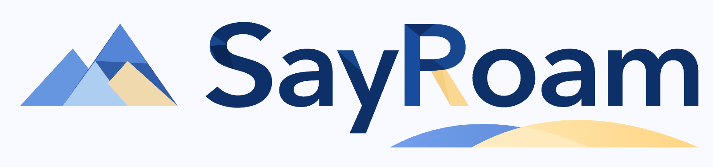
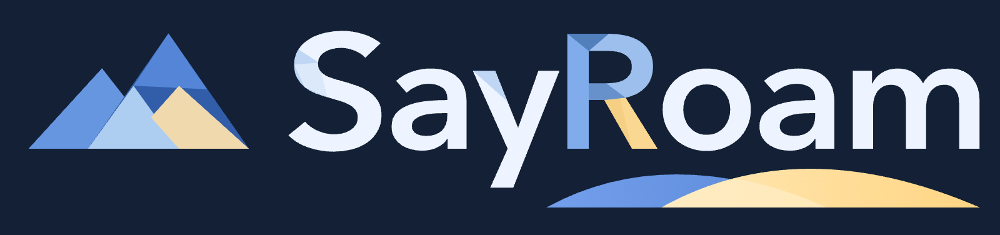
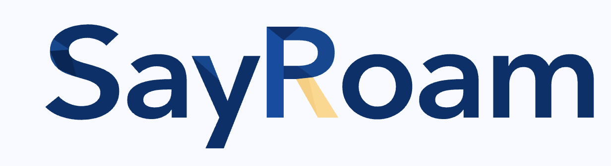
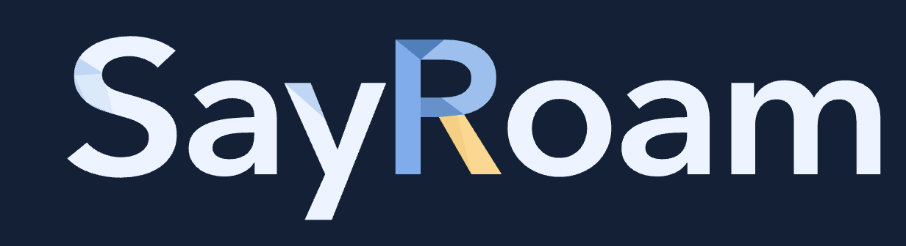
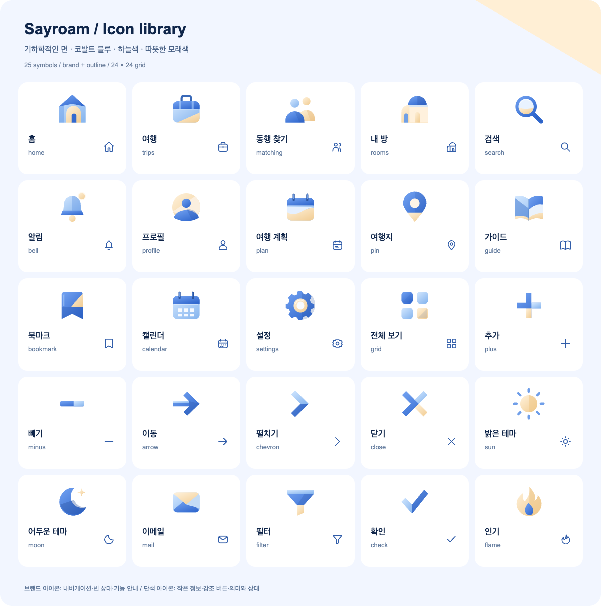
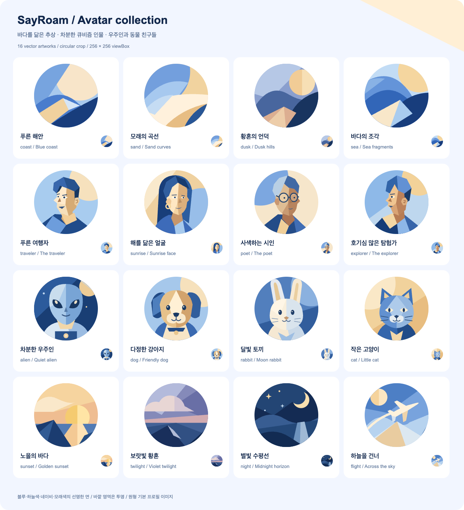

# SayRoam 스타일 가이드북

SayRoam은 파랑·하늘색·모래색·네이비의 큐비즘 여행 일러스트와 간결한 제품 UI를 함께 사용합니다.
큰 비대칭 색면, 직선과 원호, 겹쳐진 기하학적 면이 시각 기준입니다. 화면의 정보와 조작은
읽기 쉬운 산세리프로 정리하고, 그림의 장식성을 버튼·입력 전체에 반복하지 않습니다.
사용자에게 보이는 브랜드 표기는 **SayRoam**입니다. 자산 경로와 코드 식별자의 `sayroam`은 소문자로 유지합니다.

이 문서는 #86의 시각 기준입니다. 구현 규칙은 [FRONTEND.md](FRONTEND.md), 화면별 배치는
[page-families.md](notes/page-families.md), 실행·실제 기능 범위는 [README.md](README.md)를 따릅니다.
현재 외형의 기준은 [공용 CSS](src/styles/app.css)와 `/brand`의 실제 공용 컴포넌트입니다.

## 실제 일러스트와 브랜드

### 해안 히어로


[해안 원본](public/images/travel-coast.jpg)은 홈 히어로와 여행 카드에 사용합니다.
밝은 왼쪽 여백에 제목·설명을 두고, 바다·배·건물의 실루엣을 가리지 않게 크롭합니다.
삼각형·사선·큰 원호를 서로 다른 크기로 겹쳐 깊이를 표현합니다. 사진처럼 사실적인 표현,
꽃 장식, 동화책 같은 인물 묘사, 잘게 흩어진 장식을 추가하지 않습니다.

### 페이지 상태 풍경


[황혼 원본](public/images/travel-dusk.jpg)은 404의 배경 카드에 사용합니다.
해안 그림의 기하학적 구조를 유지하고 남색·보랏빛 파랑·살구색으로 시간을 바꿉니다.
404 숫자와 복귀 행동은 실제 UI로 겹쳐 표시하며 이미지에 문구나 버튼을 굽지 않습니다.
이 배경 카드는 개별 콘텐츠이며 앱 전체를 감싸는 프레임으로 확대하지 않습니다.


[설산 원본](public/images/travel-highland.jpg)은 실행 오류·재시도 화면에 사용합니다.
푸른 설산과 모래길의 큰 면으로 돌아갈 길을 표현하고, 제목·오류 안내·재시도 버튼은 실제 UI로 배치합니다.


[수평선 원본](public/images/travel-horizon.jpg)은 로딩 화면에 사용합니다.
잔잔한 호수·큰 구릉·떠오르는 해로 대기 상태를 표현합니다. 실제 스피너와 상태 문구를 유지하고
그림만으로 진행 상태를 전달하지 않습니다.

| 화면                | 자산                  | 공용 상태                   |
| ------------------- | --------------------- | --------------------------- |
| 홈 히어로·해안 카드 | `travel-coast.jpg`    | `HomePage`·`TravelArtwork`  |
| 없는 페이지         | `travel-dusk.jpg`     | `PageState kind="notFound"` |
| 실행 오류·재시도    | `travel-highland.jpg` | `PageState kind="error"`    |
| 로딩·화면 준비      | `travel-horizon.jpg`  | `PageState kind="loading"`  |

404·오류·로딩의 배치와 의미는 [공용 PageState](src/components/ui/feedback/PageState.tsx),
상태별 배경·문구 대비는 [공용 CSS](src/styles/app.css)가 소유합니다. 실제 상태 화면과 `/brand`
미리보기가 같은 컴포넌트를 사용합니다. 페이지별로 배경 카드·오류 UI를 복제하지 않습니다.

### 로고와 아이콘 보드

사용자가 선택한 로고의 시각 기준은 **SayRoam**의 굵은 기하학적 산세리프, 파랑 면으로 나뉜
대문자 **R**, 모래색·금색의 R 다리, 배너 아래의 얇고 낮은 파랑·모래색 물결입니다.
기존 산 심볼과 새 워드마크를 배너로 결합하고, 좁은 영역에는 아이콘 단독·텍스트 단독 자산을 사용합니다.
물결은 배너에만 포함합니다. 워드마크는 글자가 경로로 고정된 자산을 재사용하며 일반 텍스트에
글꼴을 지정하거나 R·물결을 CSS로 다시 조합하지 않습니다.

| 형태                       | 밝은 배경                                                                 | 어두운 배경                                                                |
| -------------------------- | ------------------------------------------------------------------------- | -------------------------------------------------------------------------- |
| 배너: 산 + 워드마크 + 물결 |          |          |
| 아이콘 단독: 산 심볼       |       |       |
| 텍스트 단독: 워드마크      |  |  |

투명 자산은 밝은 화면에서 `sayroam-{logo,mark,wordmark}`, 어두운 화면에서
`sayroam-{logo,mark,wordmark}-light`를 사용합니다. 배경까지 고정해야 하는 배포 자료에는
`-on-light`·`-on-dark`를 사용합니다. 위 비교 이미지는 배경 포함 PNG이며
[브랜드 자산 안내](public/brand/README.md)에서 세 형태의 투명·배경 포함 SVG/PNG 24개를 내려받을 수 있습니다.
테마별 원본 비율과 여백을 유지하고 산 심볼·파비콘·앱 아이콘의 기존 형태를 보존합니다.



[아이콘 보드 SVG](public/brand/icon-board.svg)와 [실제 심볼 모음](public/brand/icons.svg)은 같은 계열입니다.
작은 정보·진한 버튼은 같은 아이콘의 선형 변형을 사용합니다. 그림의 생성 기준은
[일러스트 안내](public/images/README.md)에 있습니다.

### 기본 프로필 아바타



[아바타 보드 SVG](public/brand/avatar-board.svg)는 풍경 8종·큐비즘 인물 4종·캐릭터와 동물 4종의
총 16종을 보여 줍니다. 보드는 1280×1408px의 4열 4행이며 공용 `Avatar`로 같은 자산을 표시합니다.

| 계열           | 자산                                                                                                                                                                             | 표현                                                                |
| -------------- | -------------------------------------------------------------------------------------------------------------------------------------------------------------------------------- | ------------------------------------------------------------------- |
| 추상 풍경      | [coast](public/brand/avatars/coast.svg), [sand](public/brand/avatars/sand.svg), [dusk](public/brand/avatars/dusk.svg), [sea](public/brand/avatars/sea.svg)                       | 해안·모래·황혼·바다를 큰 기하학적 면으로 단순화                     |
| 시간·비행 풍경 | [sunset](public/brand/avatars/sunset.svg), [twilight](public/brand/avatars/twilight.svg), [night](public/brand/avatars/night.svg), [flight](public/brand/avatars/flight.svg)     | 석양·해질녘·밤·비행 풍경을 큰 면과 실루엣으로 표현                  |
| 큐비즘 인물    | [traveler](public/brand/avatars/traveler.svg), [sunrise](public/brand/avatars/sunrise.svg), [poet](public/brand/avatars/poet.svg), [explorer](public/brand/avatars/explorer.svg) | 사선·옆모습과 서로 다른 시선의 비대칭 얼굴                          |
| 캐릭터·동물    | [alien](public/brand/avatars/alien.svg), [dog](public/brand/avatars/dog.svg), [rabbit](public/brand/avatars/rabbit.svg), [cat](public/brand/avatars/cat.svg)                     | 외계인·강아지·토끼·고양이의 정면 특징을 단순한 면과 실루엣으로 표현 |

원형 크롭 안에 주요 면·눈·코의 실루엣이 남도록 정사각형 원본을 사용합니다. 파랑·하늘색·모래색·
네이비를 중심으로 구성하고 황혼 변형에만 따뜻한 살구색을 보탭니다. 사진 같은 피부·세밀한 얼굴
묘사보다 24~40px에서도 알아볼 수 있는 큰 색면과 단순한 형태를 우선합니다.
인물은 사선·옆모습·자연스러운 3/4 방향으로 시선과 얼굴 각도를 다양하게 구성합니다.
캐릭터·동물은 정면을 기준으로 눈·코·귀의 특징을 표현합니다. 두 계열 모두 기하학적 면을 유지하고
주요 특징이 원형 크롭에서 잘리지 않게 합니다.
작은 프로필에 불필요한 테두리·장식·텍스트를 겹치지 않고 기존 사진이 있는 사용자는 해당 사진을 유지합니다.
계정 상태별 기본 이미지는 아래 기준을 사용합니다. 16종 자산의 브랜드 미리보기를 기본 계정 동작과 혼동하지 않습니다.

| 계정 상태                  | 이미지                                                                         |
| -------------------------- | ------------------------------------------------------------------------------ |
| 로그아웃                   | [anonymous-profile.svg](public/brand/anonymous-profile.svg)의 차분한 빈 실루엣 |
| 로그인, 사진 없음          | [coast.svg](public/brand/avatars/coast.svg)                                    |
| 로그인, 사진 불러오기 실패 | `coast.svg`로 대체                                                             |
| 로그인, 사진 정상          | 사용자 사진 유지                                                               |

풍경·인물·캐릭터와 동물은 같은 크기·크롭 규칙을 공유합니다. 상태 배지나 버튼의 접근 가능한 이름은 실제 UI가 소유합니다.

## 색상·간격·형태

색은 `src/styles/app.css`의 토큰으로 사용합니다. 아래 값은 라이트 기준이며 다크 모드에서는
같은 토큰의 다크 값을 사용합니다. 화면별로 라이트 색상을 고정하지 않습니다.

| 역할             | 토큰·기준                                       | 사용                       |
| ---------------- | ----------------------------------------------- | -------------------------- |
| 바탕             | `--bg: #f8faff`                                 | 뷰포트와 본문              |
| 표면             | `--surface: #ffffff`                            | 카드·입력·모달             |
| 주요 파랑        | `--primary: #2563eb`                            | 주요 조작·선택·포커스      |
| 하늘색           | `--sky: #60a5fa`                                | 그림·아이콘의 밝은 면      |
| 모래색           | `--sand: #fee3c3`                               | 그림·아이콘의 따뜻한 면    |
| 진한 버튼        | `--button-bg: #1e3c6b`                          | 네이비 주요 행동           |
| 본문             | `--text: #0f172a`                               | 제목·정보                  |
| 보조 문구        | `--secondary-text: #576782`                     | 설명·메타 정보             |
| 테두리·선택 바탕 | `--border: #e4eaf5`, `--active-bg: #e6eeff`     | 입력 경계·선택 상태        |
| 성공·충족        | `--success: #24734f`                            | 성공 결과·완료된 검증 조건 |
| 오류·미충족      | `--danger: #b42318`                             | 필드 오류·미완료 검증 조건 |
| 간격             | `--space-1/2/3/4/5/6/8`: 4/8/12/16/20/24/32px   | 배치·패딩                  |
| 기본 컨트롤·입력 | 기본 8px / 입력 12px 곡률                       | 기존 공용 컴포넌트 사용    |
| 카드·패널        | 일반 12px / 패널 16px / 여행 콘텐츠 22px        | 정보의 크기에 맞춰 사용    |
| 모달·둥근 버튼   | 모달 24px / `--radius-pill: 999px`              | 대화상자·검색/주요 버튼    |
| 조작 높이        | `--control-height: 36px`, 일반 모바일 44px 기준 | 키보드·터치 조작           |

네이비는 제목·주요 버튼의 중심이고 하늘색·모래색은 그림의 면을 구분합니다.
채워진 주요·브랜드·소프트 버튼은 단색 면을 사용하고 장식 테두리·안쪽 하이라이트를 넣지 않습니다.
어두운 테마의 카드는 테두리를 두르지 않고, 배경보다 밝은 남색 표면과 부드러운 그림자로 구분합니다.
입력·선택·포커스의 경계는 상태를 알아볼 수 있도록 유지합니다.
의미 없는 회색 카드·강한 테두리로 안내를 둘러싸지 않습니다. 검증 안내는 파랑을 약하게 섞은
표면과 12px 문구로 정리하고, 충족 수 배지를 덧붙이지 않습니다. 색 외에도 체크·오류 표시와
문구로 상태를 전달합니다. 제목·본문은 시스템 산세리프를 사용하고 워드마크는 사용자 선택 로고의
기하학적 글자·R·물결을 담은 제공 경로 자산을 사용합니다.

## 화면 구성

- 앱 셸은 뷰포트 전체 폭과 높이를 사용합니다. 바깥 여백·그림자·둥근 모서리를 가진 하나의 거대한 앱 카드를 만들지 않습니다.
- 홈은 히어로 → 목적지·일정·인원 검색 → 바로가기 → 여행·동행·방 요약 순서로 구성합니다. 히어로와 개별 콘텐츠 카드의 곡률은 허용합니다.
- 데스크톱은 상단 내비게이션과 넓은 정보 배치를, 모바일은 하단 내비게이션과 간결한 목록을 사용합니다. 고정 높이로 긴 번역문을 자르지 않습니다.
- 시작·온보딩·업무 화면 목업은 `/brand?preview=welcome`, `onboarding`, `home`, `trips`, `matching`, `rooms`에서 확인합니다. 각각 `preview` 값 하나를 사용합니다.
- 모달은 공용 `Modal`을 사용합니다. 로그인 폭은 최대 380px, 가입·재설정은 400px, 일반 모달은 420px 기준입니다. 작은 화면에서는 화면 가장자리 여백을 확보합니다.
- 긴 인증 폼은 모달 본문 내부에서 스크롤합니다. 제목·닫기를 고정하고 모서리 밖으로 스크롤바가 튀어나오지 않게 합니다. Escape·포커스 제한·닫힌 뒤 포커스 복원을 유지합니다.

여행·동행·방과 목업의 데이터는 예시입니다. 기존 실제 인증과 `/trips`·`/rooms` 보호 경로를
디자인 미리보기 때문에 우회하거나 바꾸지 않습니다.

## 공용 UI 사용

공개 진입점은 [components/ui/index.ts](src/components/ui/index.ts)입니다. 새 외형을 화면에
직접 만들기 전에 같은 공용 컴포넌트와 `/brand`의 예시를 확인합니다.

| 대상                                           | 사용 기준                                                                                                                                                                                                                                                                                        |
| ---------------------------------------------- | ------------------------------------------------------------------------------------------------------------------------------------------------------------------------------------------------------------------------------------------------------------------------------------------------ |
| `Icon`                                         | 기본 `variant="brand"`로 면 분할 색상을 사용합니다. 작은 메타 정보나 진한 버튼은 `variant="outline"`으로 같은 아이콘의 선형 변형을 사용합니다.                                                                                                                                                   |
| `AvatarPicker`·`IconChoiceGroup`·`ThemePicker` | 프로필·성별·테마 선택은 실제 화면과 브랜드 페이지에서 같은 컴포넌트를 사용합니다. 선택 배경·문구는 `--selection-bg`·`--selection-text`를 공유하고 원형·미리보기 형태는 유지합니다.                                                                                                               |
| `Avatar`                                       | 16종 자산과 사용자 사진을 원형으로 표시합니다. 로그인 계정의 사진 없음·실패 기본값은 `coast`, 로그아웃 표시는 별도 익명 실루엣을 사용합니다.                                                                                                                                                     |
| 여행·날짜 아이콘                               | 여행 진입·여행 계획 바로가기는 내비게이션과 같은 여행가방 `name="trips"`, 날짜 정보·날짜 선택은 `name="calendar"`를 사용합니다.                                                                                                                                                                  |
| `TravelArtwork`                                | `scene="coast\|city\|mountain\|island"`로 기존 그림을 재사용합니다. 장식 그림은 빈 대체 텍스트 또는 `aria-hidden`을 유지합니다.                                                                                                                                                                  |
| `Button`·`ButtonLink`                          | 기본 파란 주요 행동은 기존 `brand` 계열을 사용합니다. 인증 코드 발송·확인도 충분한 대비의 파란 버튼으로 표시합니다. 링크형 배치는 `plain`을 사용합니다.                                                                                                                                          |
| `TextField`·`Checkbox`                         | 입력 오류를 `error`·`aria-describedby`로 연결합니다. 로그인 유지 안내는 체크 형태를 유지하고 실제 서버 정책을 임의로 바꾸지 않습니다.                                                                                                                                                            |
| `FilePicker`·`ImageCropDialog`                 | 파일 선택과 원형 영역 이동·모서리 크기 조절을 공유합니다. 사진 적용은 페이지의 업로드 액션을 호출하며, 공용 UI가 API를 직접 호출하지 않습니다.                                                                                                                                                   |
| `VerificationCode`                             | 여섯 자리 숫자·붙여넣기·자동 완성·방향키·Backspace를 공유합니다.                                                                                                                                                                                                                                 |
| `Divider`·`MenuItem`                           | 설정 구분선과 프로필·선택 드롭다운 항목의 간격·선택 외형을 공유합니다.                                                                                                                                                                                                                           |
| `DatePicker`·`NumberStepper`                   | 브라우저 기본 날짜 팝업·숫자 스피너 대신 공용 달력·증감 컨트롤을 조합합니다. 날짜·인원과 경계값은 상태 소유자가 관리합니다.                                                                                                                                                                      |
| `DropdownMenu`                                 | 선택 항목은 체크, 화살표는 트리거 오른쪽 끝에 둡니다. 열림 상태에서 방향을 회전하고 열기·닫기 양쪽에 짧은 전환을 적용합니다.                                                                                                                                                                     |
| `KeyboardShortcut`                             | 설정과 툴팁을 포함해 테마에 맞는 작은 연결 캡슐로 표시합니다. 단축키 전체를 브랜드 그림 아이콘으로 바꾸지 않습니다.                                                                                                                                                                              |
| `Toast`                                        | 작업 결과를 가운데 정렬한 캡슐로 표시합니다. 성공은 브랜드 남색, 오류는 빨강으로 구분하고 모든 토스트는 아이콘 없이 문구만 표시합니다. X 버튼 없이 기본 3초(오류 6초) 후 페이드하고 포커스를 빼앗지 않습니다. 브라우저 기본 검증 팝업은 공통 오류 토스트로 바꾸고 첫 입력에 포커스를 유지합니다. |
| `Badge`·`NotificationBadge`·`FilterChips`      | 상태·읽지 않은 수·목록 필터의 기존 의미와 선택 상태를 재사용합니다.                                                                                                                                                                                                                              |

아이콘 단독 버튼은 버튼에 번역된 접근 가능한 이름을 지정합니다. 장식 SVG 자체에는 이름을
반복하지 않습니다. 툴팁·드롭다운·날짜 선택기의 DOM 인라인 좌표는 화면 경계 측정을 위한
공용 컴포넌트의 예외이며 색·곡률·모션은 공용 CSS가 소유합니다.

날짜·인원 컨트롤은 [DatePicker](src/components/ui/inputs/DatePicker.tsx)와
[NumberStepper](src/components/ui/inputs/NumberStepper.tsx)의 제어형 `value`·`onChange`를 사용합니다.
날짜의 `value`·`min`·`max`는 `YYYY-MM-DD`이며 빈 값은 미선택입니다. 달력은 방향키로 일·주를,
PageUp/Down으로 월을, Shift와 함께 누르면 연도를 이동합니다. Enter/Space로 선택하고
Escape로 닫아 트리거로 돌아갑니다. 인원 기본 범위는 1~20명이며 필요에 따라 `min`·`max`를 지정합니다.
방향키는 1, PageUp/Down은 5씩 조정하고 Home/End는 경계값으로 이동합니다.
직접 입력은 포커스를 벗어날 때 지정 범위 안의 정수로 보정합니다.
일반 입력·드롭다운·버튼은 36px 높이와 작은 패딩을 사용합니다. 일반 모바일 조작 영역은 44px, 설정·쇼케이스 모달 내부는 36px로 구성합니다. 인증 입력은 모바일 38px, 주요 제출 버튼은 데스크톱 40px·모바일 44px를 유지합니다.
일반 모달의 안쪽 여백은 데스크톱 24px·모바일 20px이며 그룹 간격은 16px를 기준으로 합니다.
홈 복합 검색의 필드는 파란 포커스 테두리 없이 연한 배경으로 반응하며, 일반 입력·버튼의 키보드 포커스와 오류 표시는 유지합니다.

## 변경할 것과 유지할 것

| 적용할 것                                    | 피할 것                                        |
| -------------------------------------------- | ---------------------------------------------- |
| 기존 그림을 크롭하고 같은 면·팔레트로 확장   | 사진풍 풍경·꽃·동화풍 장식으로 계열 변경       |
| 같은 의미에는 같은 아이콘과 변형 사용        | 여행 진입마다 달력·가방·다른 그림을 혼용       |
| 어긋난 간격·대비·계층·조작만 조정            | 이미 적절한 공용 UI를 디자인 작업마다 재작성   |
| 실제 공용 UI를 브랜드 페이지에도 표시        | 브랜드 페이지 전용으로 비슷한 UI 복제          |
| `src/locales/ko.json`·`en.json`을 함께 갱신  | JSX 문구 하드코딩·영어에서 잘리는 고정 폭      |
| 라이트·다크 토큰과 모션 줄이기 유지          | 라이트 색상 고정·필수 동작을 애니메이션에 의존 |
| 재사용 자산만 저장하고 화면 캡처는 PR에 첨부 | 검증 스크린샷을 소스·가이드 자산으로 커밋      |

## 검증과 작업 지시문

배치·상호작용이 바뀐 대표 화면을 실제 브라우저에서 확인합니다. 390px 모바일·1440px 데스크톱을
기준으로 잘림·겹침·내부 스크롤·터치 영역을 확인하고 영향을 받는 라이트/다크·한영 문구를 비교합니다.
Tab·Shift+Tab·Escape와 포커스 복원, 달력·드롭다운의 키보드 조작, 모션 줄이기를 확인합니다.
화면 캡처를 포함할 경우 PR 첨부 자료로 관리합니다. 정적 검사 통과만으로 시각 검증 완료를 주장하지 않습니다.

코드 변경은 영향에 맞는 타입·린트·UI·번역·포맷 검사와 빌드를 실행합니다. 문서만 바뀌면
링크·포맷을 확인하며 이미 통과한 검사를 관련 변경 없이 반복하지 않습니다.

다른 에이전트에게 다음 지시문과 변경할 화면을 함께 전달할 수 있습니다.

```text
frontend/AGENTS.md, FRONTEND.md, STYLE_GUIDE.md, notes/page-families.md를 읽고 작업해 주세요.
기존 실제 화면과 /brand의 공용 컴포넌트부터 확인하고 변경할 화면의 문제만 수정하세요.
SayRoam은 파랑·하늘색·모래색·네이비, 큰 비대칭 색면과 직선·원호의 큐비즘 여행 스타일입니다.
로고는 사용자 선택 기준의 SayRoam 배너·아이콘·워드마크와 테마별 투명/배경 포함 경로 자산을 재사용하세요.
public/images/travel-coast.jpg와 public/brand/icon-board.svg를 참고하세요.
공용 PageState의 404는 travel-dusk.jpg, 오류는 travel-highland.jpg, 로딩은 travel-horizon.jpg를 사용하세요.
public/brand/avatar-board.svg의 풍경·큐비즘 인물·캐릭터와 동물 16종과 공용 Avatar를 사용하세요.
계정 프로필은 로그아웃 시 anonymous-profile.svg, 로그인 후 사진이 없거나 실패하면 coast.svg를 사용하세요.
인물은 사선·옆모습·자연스러운 3/4 방향으로, 캐릭터·동물은 정면을 기준으로 구성하세요.
모두 기하학적 면과 작은 원형 크롭에서의 실루엣을 유지하세요.
앱은 뷰포트 전체 폭이며 바깥 둥근 카드 프레임을 추가하지 마세요. 콘텐츠 카드·모달은 허용합니다.
기존 브랜드 아이콘과 공용 입력·날짜 선택·인원 증감·드롭다운·토스트·모달·단축키 캡슐을 재사용하세요.
여행 진입은 trips, 날짜는 calendar 아이콘입니다. 토스트 기본은 3초와 자연스러운 페이드입니다.
색·간격·모션은 app.css 토큰, 사용자 문구는 ko/en 리소스로 관리하세요.
기존 인증·보호 경로와 예시 여행 데이터의 범위를 유지하고 백엔드·계약을 임의로 바꾸지 마세요.
영향받는 모바일·데스크톱과 키보드·테마 상태를 확인하고 구현과 실제 검증 결과를 구분해 보고하세요.
화면 캡처는 저장소에 추가하지 말고 PR 첨부 자료로만 사용하세요.
```
