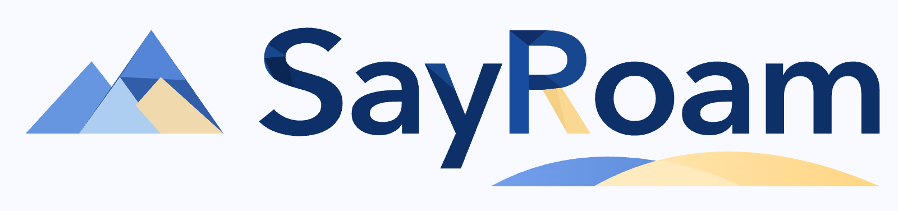
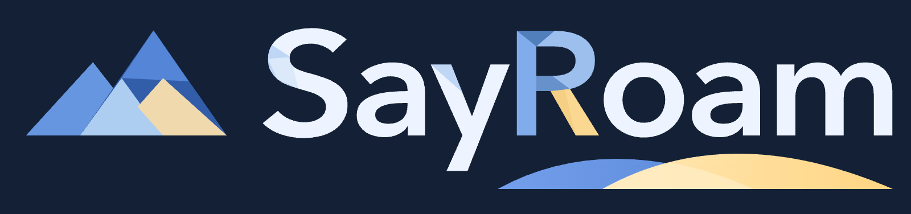
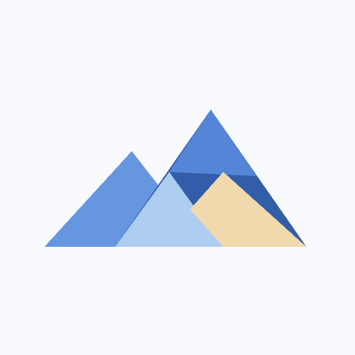
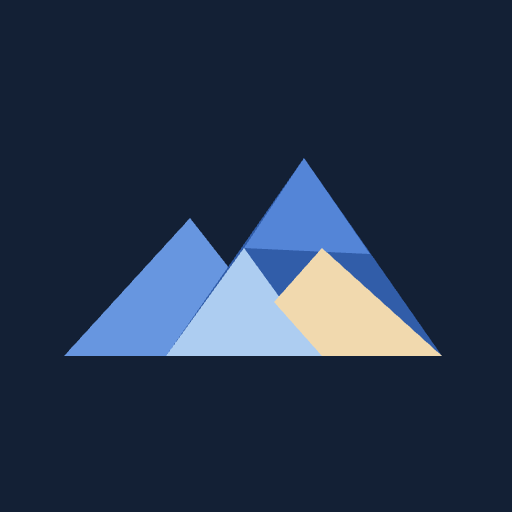
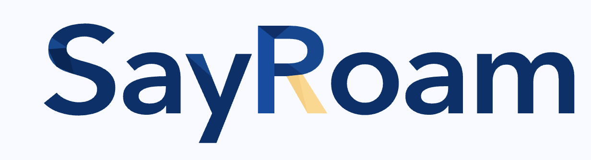
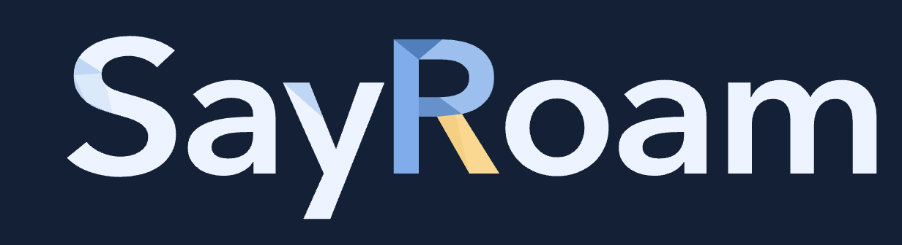
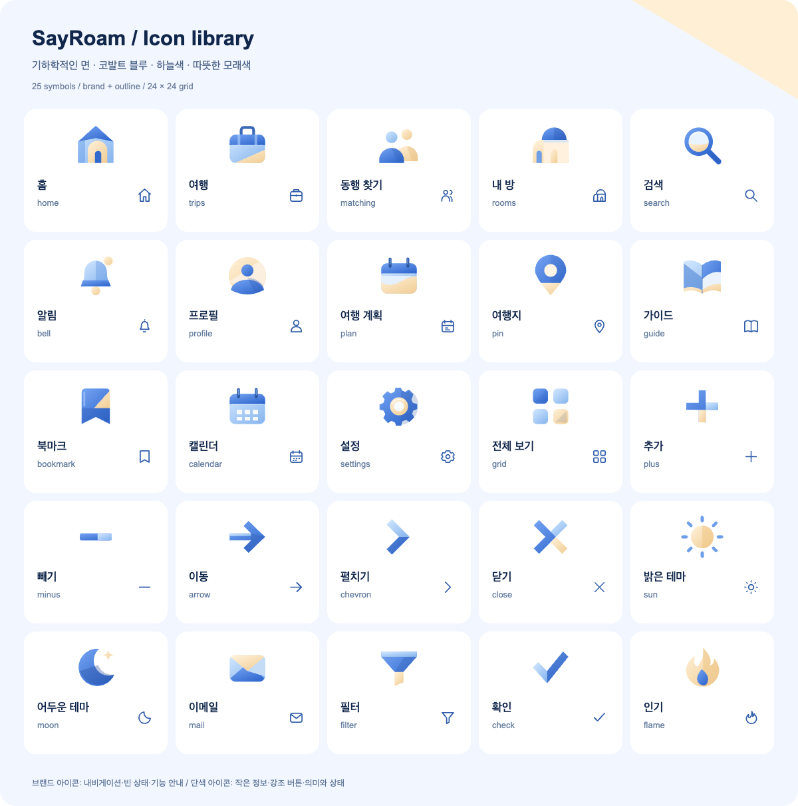
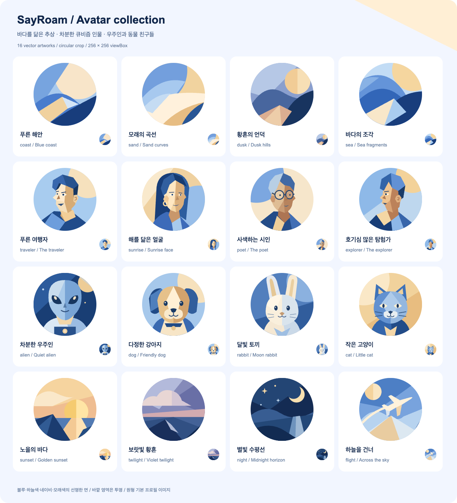

# SayRoam 브랜드 자산

시각 기준과 공용 UI 사용법은 [스타일 가이드북](../../STYLE_GUIDE.md)을 따릅니다.
사용자에게 보이는 표기는 **SayRoam**이며 자산 경로의 `sayroam`은 소문자로 유지합니다.
파랑·하늘색·모래색·네이비의 면 분할과 사용자가 선택한 굵은 기하학적 워드마크를 사용합니다.

## 배너·아이콘·워드마크

배너는 기존 산 심볼과 새 SayRoam 워드마크를 조합합니다. 대문자 R의 파랑 면·모래색/금색 다리와
하단의 얇은 물결이 선택한 로고의 기준입니다. 아이콘 단독은 기존 산 형태를, 텍스트 단독은
같은 경로 글자를 사용하며 물결은 배너에만 넣습니다. SVG의 글자는 경로로 고정되어 있어 실행 시
폰트 파일이 필요하지 않습니다. 일반 텍스트·CSS로 로고를 다시 조합하지 않습니다.

| 형태        | 밝은 배경                                                    | 어두운 배경                                                   |
| ----------- | ------------------------------------------------------------ | ------------------------------------------------------------- |
| 배너        |          |          |
| 아이콘 단독 |       |       |
| 텍스트 단독 |  |  |

접미사가 없는 원본은 밝은 화면용 투명 자산, `-light`는 어두운 화면용 투명 자산입니다.
`-on-light`는 `#f8faff`, `-on-dark`는 `#132035` 배경을 포함한 불투명 자산입니다.
테마·배포 배경에 맞는 버전을 선택하고 원본 비율·색·여백을 유지합니다.

다음 표는 세 형태의 투명·배경 포함 SVG/PNG **24개**를 제공합니다.

| 형태·PNG 크기            | 투명·밝은 화면용                                          | 투명·어두운 화면용                                                    | 밝은 배경 포함                                                              | 어두운 배경 포함                                                          |
| ------------------------ | --------------------------------------------------------- | --------------------------------------------------------------------- | --------------------------------------------------------------------------- | ------------------------------------------------------------------------- |
| 배너 · 1600×376px        | [SVG](sayroam-logo.svg) · [PNG](sayroam-logo.png)         | [SVG](sayroam-logo-light.svg) · [PNG](sayroam-logo-light.png)         | [SVG](sayroam-logo-on-light.svg) · [PNG](sayroam-logo-on-light.png)         | [SVG](sayroam-logo-on-dark.svg) · [PNG](sayroam-logo-on-dark.png)         |
| 아이콘 단독 · 512×512px  | [SVG](sayroam-mark.svg) · [PNG](sayroam-mark.png)         | [SVG](sayroam-mark-light.svg) · [PNG](sayroam-mark-light.png)         | [SVG](sayroam-mark-on-light.svg) · [PNG](sayroam-mark-on-light.png)         | [SVG](sayroam-mark-on-dark.svg) · [PNG](sayroam-mark-on-dark.png)         |
| 텍스트 단독 · 1232×336px | [SVG](sayroam-wordmark.svg) · [PNG](sayroam-wordmark.png) | [SVG](sayroam-wordmark-light.svg) · [PNG](sayroam-wordmark-light.png) | [SVG](sayroam-wordmark-on-light.svg) · [PNG](sayroam-wordmark-on-light.png) | [SVG](sayroam-wordmark-on-dark.svg) · [PNG](sayroam-wordmark-on-dark.png) |

| 기타 자산                                                           | 용도·크기                                       |
| ------------------------------------------------------------------- | ----------------------------------------------- |
| [앱 아이콘 SVG](sayroam-app-icon.svg) · [PNG](sayroam-app-icon.png) | 파란 배경판을 포함한 기존 산 심볼 · 512×512px   |
| [파비콘 SVG](favicon.svg) · [PNG](favicon.png)                      | 산 심볼만 남긴 투명 배경 · 64×64px              |
| [익명 프로필 SVG](anonymous-profile.svg)                            | 로그아웃 상태의 차분한 빈 실루엣 · 32×32 좌표계 |

파비콘·앱 아이콘·아이콘 단독의 기존 산 형태는 보존합니다. 로그아웃 프로필은 별도 익명 자산을
사용하고 로그인 계정의 사진 없음·불러오기 실패 기본값은 `avatars/coast.svg`입니다.

## 브랜드 아이콘

[아이콘 보드 SVG](icon-board.svg)·[PNG](icon-board.png)에서 실제 25종의 브랜드/선형 변형을
비교할 수 있습니다. 앱에서는 [icons.svg](icons.svg)를 공용 `Icon`으로 표시합니다.

`home`, `trips`, `matching`, `rooms`, `profile`, `settings`, `grid`, `bell`, `search`,
`bookmark`, `plus`, `minus`, `arrow`, `chevron`, `close`, `sun`, `moon`, `mail`, `filter`,
`pin`, `guide`, `check`, `flame`, `plan`, `calendar`를 제공합니다.

기본 `variant="brand"`는 파랑·하늘색·모래색을 겹친 면을 표시합니다. 작은 메타 정보나 진한
버튼 안에서는 `variant="outline"`으로 같은 의미의 선형 아이콘을 선택합니다. 모든 아이콘은
24px 좌표계를 공유하고 선형 변형은 `currentColor`를 따릅니다. 여행 진입은 내비게이션과 같은
여행가방 `trips`, 날짜 정보는 `calendar`를 사용합니다. 검색·동행·설정만 다른 아이콘 라이브러리로
교체하지 않습니다. 단축키는 그림 아이콘 대신 공용 `KeyboardShortcut` 키캡으로 표시합니다.

## 기본 프로필 아바타

[아바타 보드 SVG](avatar-board.svg)·[PNG](avatar-board.png)는 아래 SVG 원본의 공용 사용 기준입니다.
보드는 1280×1408px의 4열 4행 구성이며 개별 자산은 256×256 좌표계의 SVG입니다. 원형 영역 바깥은 투명하고
별도 개별 PNG는 제공하지 않습니다.

| 계열               | 자산                                                                                                                         |
| ------------------ | ---------------------------------------------------------------------------------------------------------------------------- |
| 추상 풍경 4종      | [coast](avatars/coast.svg), [sand](avatars/sand.svg), [dusk](avatars/dusk.svg), [sea](avatars/sea.svg)                       |
| 시간·비행 풍경 4종 | [sunset](avatars/sunset.svg), [twilight](avatars/twilight.svg), [night](avatars/night.svg), [flight](avatars/flight.svg)     |
| 큐비즘 인물 4종    | [traveler](avatars/traveler.svg), [sunrise](avatars/sunrise.svg), [poet](avatars/poet.svg), [explorer](avatars/explorer.svg) |
| 캐릭터·동물 4종    | [alien](avatars/alien.svg), [dog](avatars/dog.svg), [rabbit](avatars/rabbit.svg), [cat](avatars/cat.svg)                     |

공용 `Avatar`에서 원형 크롭으로 사용하며 내비게이션·프로필·브랜드 보기의 기본 프로필을
같은 계열로 맞춥니다. 총 16종은 풍경 8종·인물 4종·캐릭터와 동물 4종입니다.
계정 프로필은 로그아웃 시 `anonymous-profile.svg`, 로그인 후 사진이 없거나 불러오기에 실패하면
[coast.svg](avatars/coast.svg)를 사용합니다. 정상 사진은 유지합니다.
파랑·하늘색·모래색·네이비의 큰 색면을 유지하고 인물은 비대칭 면과
단순한 눈·코로 구성합니다. 인물은 사선·옆모습·자연스러운 3/4 방향으로 시선을 다양하게 하고,
캐릭터·동물은 정면을 기준으로 표현합니다. 기하학적 면과 작은 원형 크롭에서의 주요 실루엣을 유지하고 사진이 있는 사용자의
프로필을 임의로 덮어쓰지 않습니다. 상세 사용 원칙은 스타일 가이드북을 따릅니다.

## 로그인 제공자

Google·카카오·네이버 자산은 [공식 제공자 자산](providers/README.md)을 사용합니다.
제공자 로고의 공식 형태·색상을 브랜드 팔레트로 다시 그리지 않습니다. 이 디렉터리에는 재사용
자산만 저장하며 화면 검증 캡처는 PR에 첨부합니다.
