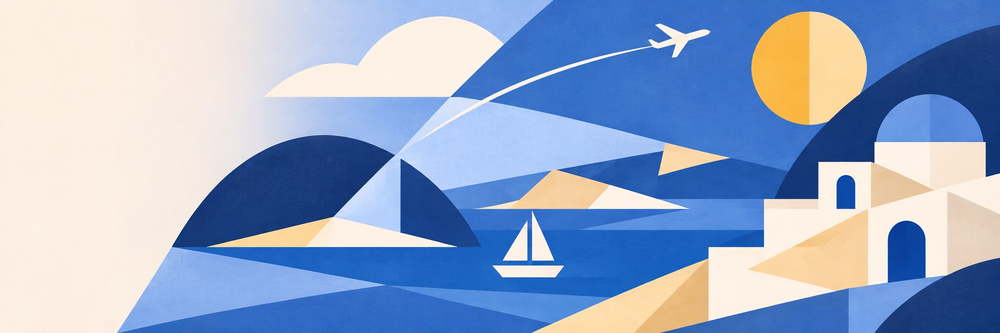
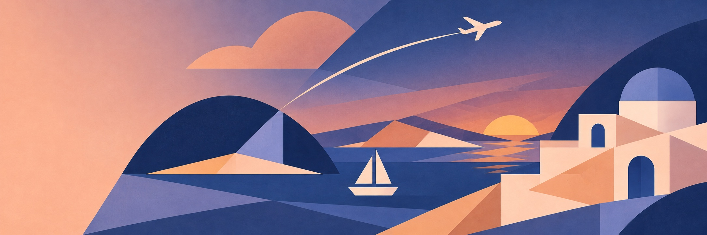
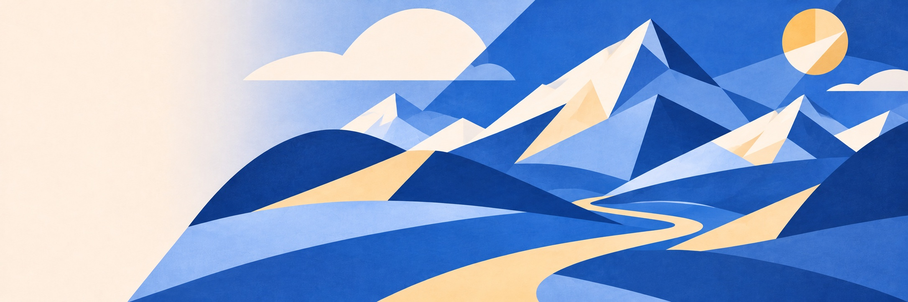
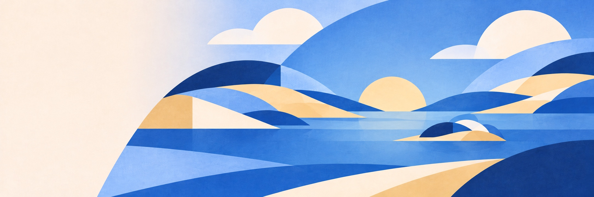

# 여행 일러스트

상위 시각 기준은 [스타일 가이드북](../../STYLE_GUIDE.md)입니다. 아래 그림은 #86의 재사용 디자인
자산이며 화면 캡처가 아닙니다. 사용자 참고 디자인을 기준으로 내장 `image_gen` 도구로 생성하고
JPEG로 최적화했습니다. 이미지에 문구·버튼·UI를 넣지 않고 실제 화면에서 조합합니다.

| 자산                                       | 용도                     | 시각 기준                                                                         |
| ------------------------------------------ | ------------------------ | --------------------------------------------------------------------------------- |
| [travel-coast.jpg](travel-coast.jpg)       | 홈 히어로·해안 여행 카드 | 파랑·하늘색·모래색, 비대칭 큰 색면·원호·직선, 바다·돛단배·기하학 건물·분할된 태양 |
| [travel-dusk.jpg](travel-dusk.jpg)         | 404 배경 카드            | 같은 면 분할 풍경을 네이비·보랏빛 파랑·살구·테라코타의 황혼으로 변주              |
| [travel-highland.jpg](travel-highland.jpg) | 오류·재시도 배경 카드    | 푸른 설산과 모래길을 큰 큐비즘 면으로 구성                                        |
| [travel-horizon.jpg](travel-horizon.jpg)   | 로딩 배경 카드           | 잔잔한 호수·큰 구릉·떠오르는 해를 단순한 수평 면으로 구성                         |

해안 생성 기준: 큰 삼각형·원호·각진 면이 겹치는 모던 아트 여행 풍경, 중앙의 바다와 단순한
돛단배, 오른쪽의 그리스 건물과 반으로 나뉜 태양, 왼쪽의 밝은 문구 여백을 사용합니다.
황혼은 동일한 기하학 구조에서 남색 바다·살구빛 하늘·따뜻한 건물 면으로 시간을 표현합니다.
설산·수평선은 기존 해안 일러스트를 스타일 참고로 사용해 생성하고 JPEG 품질 88로 최적화했습니다.
설산은 푸른 산과 밝은 모래길, 수평선은 평온한 호수와 떠오르는 해를 중심으로 같은 면 분할을 유지합니다.
사진 질감·꽃 장식·동화풍 인물·문자·UI는 넣지 않습니다.

크롭할 때 밝은 문구 영역과 주요 실루엣을 확인합니다. 상태 화면은
[공용 PageState](../../src/components/ui/feedback/PageState.tsx)가 소유하고 아래 배경을
[공용 CSS](../../src/styles/app.css)에서 연결합니다.

| `PageState` 상태 | 배경                  | 실제 UI          |
| ---------------- | --------------------- | ---------------- |
| `notFound`       | `travel-dusk.jpg`     | 404·안내·홈 이동 |
| `error`          | `travel-highland.jpg` | 오류 안내·재시도 |
| `loading`        | `travel-horizon.jpg`  | 스피너·상태 문구 |

문구·버튼·스피너는 이미지에 포함하지 않고 실제 화면과 브랜드 예시에서 같은 공용 UI를 사용합니다. 여행
카드의 장식 그림은 공용 `TravelArtwork`로 조합합니다. 새 그림은 같은 구도 규칙과 팔레트로
확장하고 기존 그림을 무관한 스타일로 교체하지 않습니다. 화면 검증 캡처는 PR에 첨부하고
이 디렉터리에 추가하지 않습니다.
