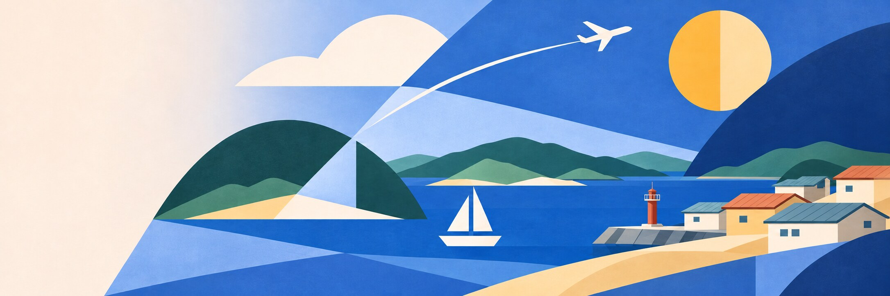
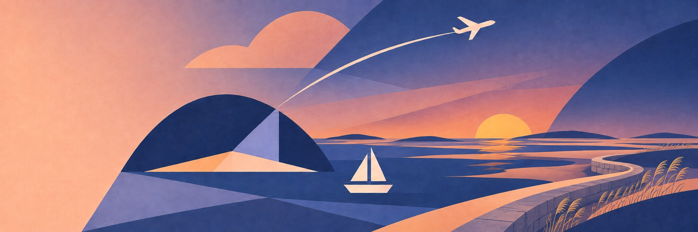
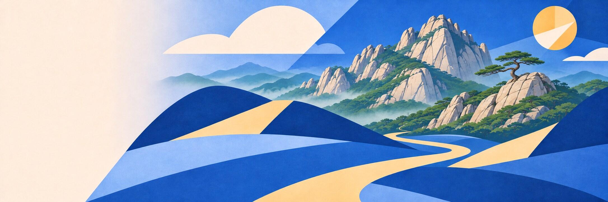
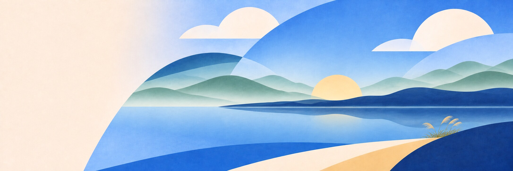

# 국내 여행 사진과 여행 일러스트

## 홈 여행지 사진

홈에 들어올 때 현재 테마에서 한 장을 무작위로 고릅니다. 각 사진은 가로 16:9(1920px·3840px)와 세로 9:16(1440×2560px) WebP로 제공합니다.

| 테마   | 사진                                                   | 촬영자와 원본                                                |
| ------ | ------------------------------------------------------ | ------------------------------------------------------------ |
| 라이트 | [부산 감천문화마을](destinations/gamcheon.webp)        | [Sean Lee](https://unsplash.com/photos/Jr8as6DTews)          |
| 라이트 | [귤나무 돌담](destinations/citrusWall.webp)            | [Insung Yoon](https://unsplash.com/photos/yd0fvnhs5QM)       |
| 라이트 | [흰 등](destinations/whiteLanterns.webp)               | [Valery Rabchenyuk](https://unsplash.com/photos/5I_oFqB0n6g) |
| 라이트 | [제주 전농로 벚꽃길](destinations/cherryBlossoms.webp) | [Ji Seongkwang](https://unsplash.com/photos/CX7fI2LXJgo)     |
| 라이트 | [꽃이 핀 가게 앞](destinations/blossomStorefront.webp) | [Timothy Ries](https://unsplash.com/photos/S5XsDlChGAQ)      |
| 다크   | [자물쇠](destinations/loveLocks.webp)                  | [Clark Gu](https://unsplash.com/photos/jQSDCkMnvFg)          |
| 다크   | [단청 야경](destinations/litEaves.webp)                | [Clark Gu](https://unsplash.com/photos/WrSuADjF_fI)          |
| 다크   | [서울 광장시장](destinations/gwangjang.webp)           | [Mike Swigunski](https://unsplash.com/photos/dbUCy23Bn8g)    |
| 다크   | [궁궐 대문 야경](destinations/palaceGateNight.webp)    | 사용자 제공 사진                                             |

Unsplash 사진의 이용 조건은 [Unsplash 라이선스](https://unsplash.com/license)에서 확인할 수 있습니다.

## 여행 일러스트

상위 시각 기준은 [스타일 가이드북](../../STYLE_GUIDE.md)입니다. 아래 그림은 #86의 재사용 디자인
자산이며 화면 캡처가 아닙니다. 사용자 참고 디자인을 기준으로 내장 `image_gen` 도구로 생성하고
여행 카드와 상태 화면의 이미지는 JPEG로 최적화했습니다. 이미지에 문구·버튼·UI를 넣지 않고 실제 화면에서 조합합니다.

| 자산                                       | 용도                  | 시각 기준                                                 |
| ------------------------------------------ | --------------------- | --------------------------------------------------------- |
| [sayroam-coast.png](sayroam-coast.png)     | 롬 메이트 공용 배경   | 파란 해안의 기와지붕과 굽은 돌담길                        |
| [travel-coast.jpg](travel-coast.jpg)       | 해안 여행 카드        | 남해안의 푸른 섬과 어촌·방파제 등대·돛단배                |
| [travel-dusk.jpg](travel-dusk.jpg)         | 404 배경 카드         | 갯벌의 물길과 갈대, 낮은 돌제방에 비친 서해 낙조          |
| [travel-highland.jpg](travel-highland.jpg) | 오류·재시도 배경 카드 | 화강암 암릉과 솔숲을 가로지르는 산길                      |
| [travel-horizon.jpg](travel-horizon.jpg)   | 로딩 배경 카드        | 잔잔한 호수·큰 구릉·떠오르는 해를 단순한 수평 면으로 구성 |

각 그림은 기존 3:1 구도와 왼쪽 문구 여백을 살려 ImageGen으로 편집하고 JPEG 품질 88로 저장했습니다.
해안과 황혼에는 남해 어촌과 서해 갯벌을, 산길과 수평선에는 화강암 봉우리와 새벽 호수를 담았습니다.
도시와 섬 카드에는 강을 건너는 철교와 현무암 해안을 단순한 실루엣으로 표시합니다.

크롭할 때 밝은 문구 영역과 주요 실루엣을 확인합니다. 상태 화면은
[공용 PageState](../../src/components/ui/feedback/PageState.tsx)가 소유하고 아래 배경을
[공용 CSS](../../src/styles/app.css)에서 연결합니다.

| `PageState` 상태 | 배경                  | 실제 UI          |
| ---------------- | --------------------- | ---------------- |
| `notFound`       | `travel-dusk.jpg`     | 404·안내·홈 이동 |
| `error`          | `travel-highland.jpg` | 오류 안내·재시도 |
| `loading`        | `travel-horizon.jpg`  | 스피너·상태 문구 |

문구·버튼·스피너는 이미지에 포함하지 않고 실제 화면과 브랜드 예시에서 같은 공용 UI를 사용합니다. 여행
카드의 장식 그림은 공용 `TravelArtwork`로 조합합니다. 새 그림은 같은 구도 규칙과 팔레트로
확장하고 기존 그림을 무관한 스타일로 교체하지 않습니다. 화면 검증 캡처는 PR에 첨부하고
이 디렉터리에 추가하지 않습니다.
